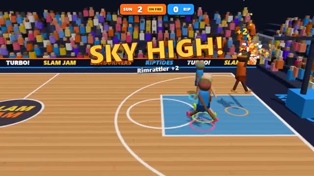

# Slam Jam

2-on-2 arcade hoops. Turbo, shove, fly, slam. A multiplayer starter game from [Multiplayer Agent](https://multiplayeragent.com): 3D, versus, 2–4 players, with bots that fill empty seats.

## How it plays

Run with turbo, shove or steal on defence, and let go of your jump shot at the top of the jump. Near the rim, SHOOT takes off for a flying dunk; score 3 in a row and you catch fire until the other team answers.

Four quarters on a short clock, a 14-second shot clock, threes from behind the arc, and an announcer who has something to say about every big play.

**Controls:** WASD or arrows, J shoot, K pass or steal, Shift turbo · touch: stick, SHOOT, PASS, TURBO.

## Make it yours in the Game Builder

Open the [Game Builder](https://multiplayeragent.com), choose **Start from a starter game** and pick Slam Jam. It opens as version 1 in your studio, ready to play and publish. Then ask for changes, for example:

- Make it a beach court at sunset with a sand floor
- Add a 4-point line way out past the 3-point line
- Give each team a special move on a meter, like a double-turbo

## Run it yourself

1. Get a free publishable key (`pk_…`) at [multiplayeragent.com](https://multiplayeragent.com).
2. In `index.html`, put it in place of `pk_REPLACE_ME` in the `MP_CONNECT` block.
3. Serve the folder with any static web server and open it (3D games load `libs/three.module.min.js` as a module, which browsers block from a plain file). No build step and no game server needed.

Without a key it still runs, offline against bots.

## How it is built

- One `index.html`, plus three.js in `libs/`. The comment at the top of the script maps the code and explains the multiplayer.
- **Host-run physics:** The host's browser owns the ball and rolls every shot, steal and block; if it leaves, the next player takes over.
- **Bots:** Bots fill every empty spot, so even alone you play a full 2-on-2.
- **Leaderboard:** Each player's most points in one game, shown on the results card.
- **Live sync:** Every baller, pass, shot and dunk moves for everyone at once.
- `?attract` runs it offline with bots only. The preview video is recorded from it.

## License

MIT.
